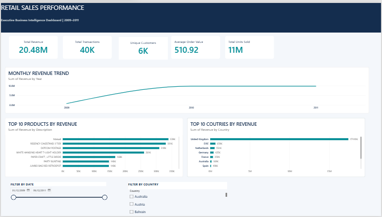

# Retail Sales Performance Analysis

## Project Overview

This project analyses retail transaction data from an online retail business to identify sales trends, customer purchasing behaviour, top-performing products, and geographical revenue performance.

The objective is to transform raw transaction data into meaningful business insights that support data-driven decision-making.

## Dataset

- **Dataset:** Online Retail II
- **Period:** December 2009 – December 2011
- **Source:** UCI Machine Learning Repository
- **Records:** Approximately 1 million transactions

## Tools and Technologies

- **Python:** Data cleaning and preparation
- **SQL:** Data querying and business analysis
- **Microsoft Excel:** Data analysis and reporting
- **Power BI:** Interactive dashboard development

## Data Cleaning

The dataset was prepared by:

- Removing cancelled transactions.
- Removing invalid and non-positive quantities and prices.
- Removing invalid dates.
- Removing duplicate records.
- Retaining missing customer IDs for revenue analysis while excluding them from customer counts.

## Key Performance Indicators

| Metric | Result |
|---|---:|
| Total Revenue | £20.48 Million |
| Total Transactions | Approximately 40,000 |
| Unique Customers | Approximately 5,878 |
| Average Order Value | Approximately £510.90 |

## Dashboard Preview

## Power BI Dashboard Features

- Monthly Revenue Trend
- Top 10 Products by Revenue
- Top 10 Countries by Revenue
- Total Revenue
- Total Transactions
- Unique Customers
- Average Order Value
- Total Units Sold
- Interactive Date and Country Filters

## Project Structure

- `Data/` – Raw and cleaned datasets
- `Python/` – Data cleaning scripts
- `SQL/` – SQL queries and analysis
- `Excel/` – Excel sales analysis report
- `Power Bi/` – Power BI dashboard and PDF export
- `Documentation/` – Project case study

## Business Value

This project demonstrates how retail transaction data can be transformed into useful business information through data cleaning, analysis, reporting, and interactive visualisation.

## Conclusion

The project demonstrates practical skills in Python, SQL, Excel, and Power BI, with an emphasis on turning raw data into meaningful business insights.

